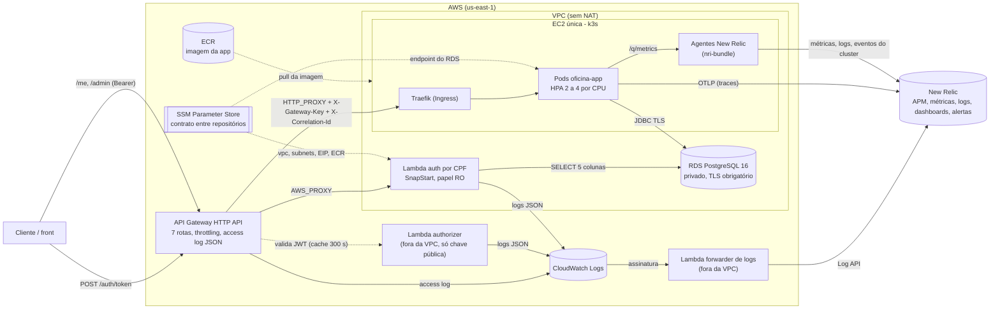
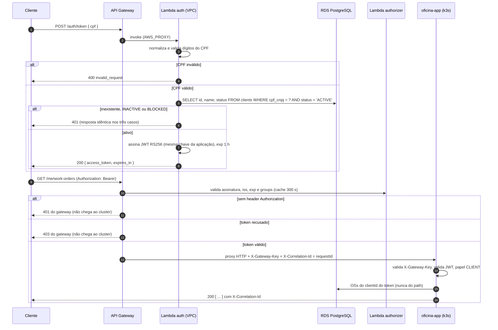
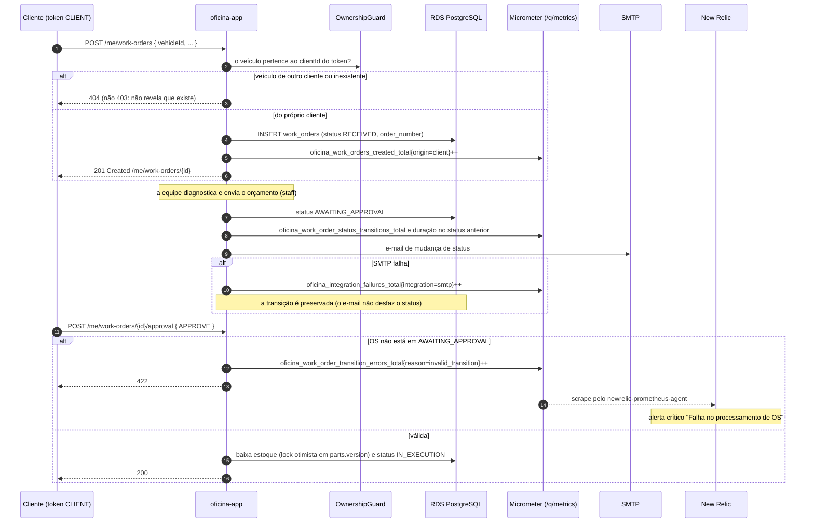

# Arquitetura — Fase 3

> Documento de arquitetura dos quatro repositórios. Diagramas em Mermaid (renderizam no GitHub e versionam como texto).
> Decisões: [`adr/`](adr/README.md) · Discussões: [`rfc/`](rfc/) · Banco: [`erd.md`](erd.md) · Operação: [`RUNBOOK.md`](RUNBOOK.md).

## 1. Contexto e repositórios

| Repositório | Responsabilidade |
|---|---|
| [`oficina-app`](https://github.com/victor-duarte-mendonca/oficina-app) | Aplicação Quarkus (domínio hexagonal), migrations Flyway, manifestos Kubernetes, pipeline de deploy, ADRs/RFCs e specs |
| [`oficina-auth-lambda`](https://github.com/victor-duarte-mendonca/oficina-auth-lambda) | Função de autenticação por CPF, Lambda authorizer, API Gateway, forwarder de logs |
| [`oficina-infra-k8s`](https://github.com/victor-duarte-mendonca/oficina-infra-k8s) | VPC, EC2/k3s, ECR, security groups, agentes New Relic e `observability/` (dashboards, alertas) |
| [`oficina-infra-database`](https://github.com/victor-duarte-mendonca/oficina-infra-database) | RDS PostgreSQL 16, parameter group, security group |

## 2. Diagrama de componentes

Mostra nuvem, APIs, banco e monitoramento. A **fronteira da VPC** explica as decisões [0005](adr/0005-lambda-na-vpc-somente-leitura.md)
e [0012](adr/0012-segredos-em-variavel-de-ambiente-do-lambda.md): só o que está dentro dela alcança o RDS, e nada dentro dela alcança a internet.

**O que atravessa a fronteira da VPC:** de entrada, apenas a invocação do gateway à função de auth e a porta 5432 do RDS (só das duas
origens permitidas: SG do cluster e SG da função). De saída, **nada**: a função de auth não tem internet, então seus logs saem pelo
CloudWatch e o forwarder, que está fora da VPC, é quem fala com o New Relic.

## 3. Sequência — autenticação por CPF e consumo de uma rota protegida

## 4. Sequência — abertura e aprovação de uma ordem de serviço

Mostra o cliente autenticado, a validação de posse do veículo, a métrica de negócio, a notificação e o caminho de erro que alimenta o
alerta de falha no processamento de OS (R7).

## 5. Modelo de dados (ER)

O diagrama e a explicação dos relacionamentos estão em [`erd.md`](erd.md); a justificativa do banco, em
[RFC 0002](rfc/0002-escolha-do-banco-de-dados.md).

## 6. Segurança em camadas

| Camada | Controle |
|---|---|
| Borda | throttling por rota; authorizer (JWT RS256); rotas internas (`/q/metrics`, `/swagger-ui`) não expostas; `X-Gateway-Key` e `X-Correlation-Id` sobrescritos |
| Rede | SG do cluster só aceita as faixas do API Gateway (porta 80) e o `/32` do aluno; API do k3s (6443) só por túnel SSM; RDS privado, TLS obrigatório; Lambda de auth sem internet |
| Aplicação | JWT revalidado; `@RolesAllowed`; posse do recurso (`OwnershipGuard`); `GatewayKeyFilter` em tempo constante |
| Dados | papel `oficina_auth_ro` somente-leitura em 5 colunas; `CHECK` de domínio; CPF mascarado em claims e logs |
| Segredos | GitHub Secrets por Environment; Secret do Kubernetes criado pela pipeline (nunca no kustomize); licença New Relic em SSM SecureString |

## 7. Limitações assumidas

- **Sem TLS entre gateway e cluster** (sem domínio): [ADR 0003](adr/0003-api-gateway-http-api.md).
- **Node único, sem HA:** [ADR 0002](adr/0002-k3s-em-ec2-unica.md).
- **Trace começa na aplicação:** o HTTP API não propaga contexto W3C; o gateway se liga por `X-Correlation-Id`
  ([ADR 0010](adr/0010-observabilidade-otlp-new-relic.md)).
- **Single-AZ, sem backup no RDS** (laboratório): [RFC 0002](rfc/0002-escolha-do-banco-de-dados.md).
